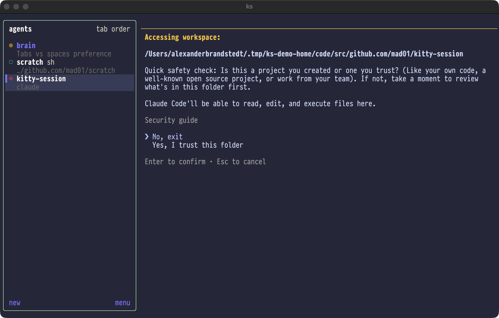
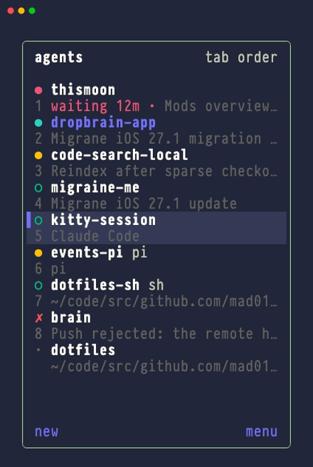
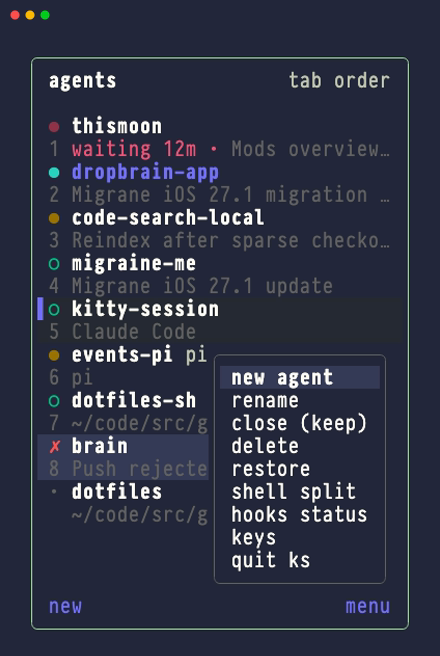
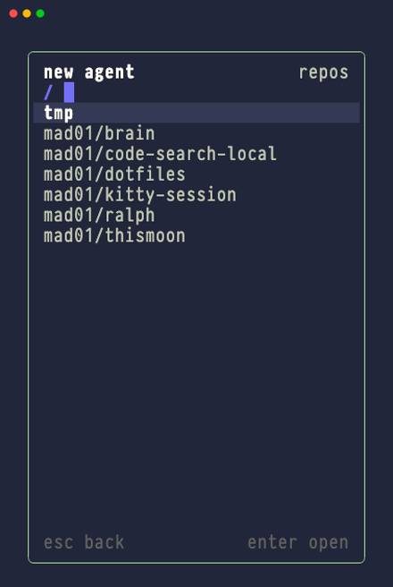
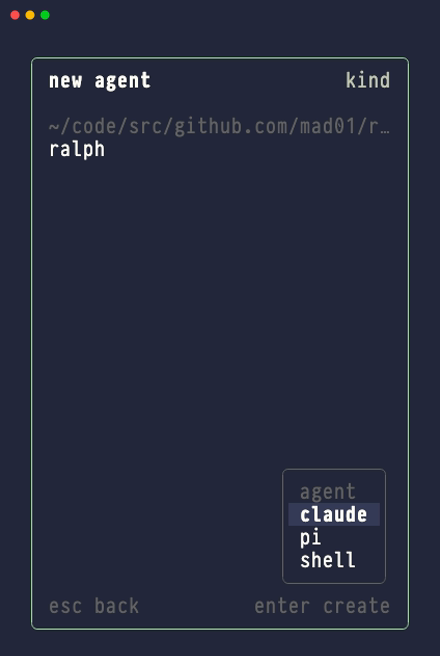
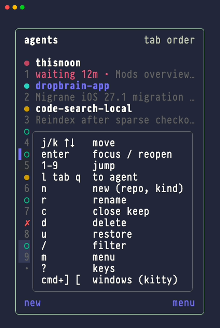

# kitty-session

`ks` is a session manager for [kitty](https://sw.kovidgoyal.net/kitty/). It runs a kitty instance of its own in which every [Claude Code](https://docs.claude.com/en/docs/claude-code/overview) session is a tab: the `ks` sidebar on the left, claude on the right. It tracks each session's state, brings every session back with one command, and lets you jump between them from the sidebar or shell scripts.

A session's right-hand window does not have to be claude. Each session record carries an agent kind: `claude` (the default), `pi`, or `shell` for a plain kitty shell with no agent. Pass `--agent pi` or `--agent shell` to `ks new` and `ks tmp`, or pick the kind in the sidebar's new-agent flow; the sidebar shows a `pi` or `sh` badge after the name of a session that is not claude's. A reopen starts the same kind again, with `pi --session` picking up pi's own session file the way `claude --resume` does for claude.

The state next to each session comes from the agent itself where it can. Claude Code and pi report what they are doing through the Program Status Protocol (Operating System Command 7501), and kitty hands those reports to `ks` with the window list it already polls. That needs a kitty newer than 0.49.2. On older releases, and for what the protocol does not carry (the session id a reopen resumes with), `ks` relies on Claude Code hooks, the window title and the pane text.

## Demo

A session tab: the `ks` sidebar on the left, Claude Code on the right, recorded from a throwaway instance with the author's kitty theme and font. Claude's folder-trust dialog puts the row in `input` (red). Accepting it and sending a prompt turns the dot amber while Claude works. The `brain` session in the background turns red when its question opens, and `1` in the sidebar jumps to it. The `scratch` row is a plain shell. `make demo-split` re-records it from `demo/split.sh`.



## Sidebar

The sidebar on fake agents, recorded from `ks _sidebar-demo` with [vhs](https://github.com/charmbracelet/vhs): the agent list, the menu, a new agent from the repo picker, and the keys popup. `make demo` re-renders the recording and the stills below from `demo/sidebar.tape`.


### Agent list

One row per session: a dot for the state (`input`, `done`, `working`, `idle`, `error`, `stopped`), then the name. A `pi` or `sh` badge follows the name when the agent is not claude. Under it sits Claude's tab title, or the session directory. The marked row is the tab the sidebar sits in. An `input` row says how long it has waited.



### Menu

`m` lists every action: new agent, rename, close, delete, restore, shell split, hooks status, keys, quit.



### New agent

`n` opens the repo picker. Type to fuzzy-filter, `enter` picks, then choose the kind: claude, pi or shell.




### Keys

`?` shows them.



## Install

You need [kitty](https://sw.kovidgoyal.net/kitty/) and the [Claude Code CLI](https://docs.claude.com/en/docs/claude-code/overview) on `PATH`; `ks` starts its own kitty instance. Go 1.25 or later is required to build from source.

```bash
make install
```

This builds `ks` and copies it to `~/code/bin/`. Adjust the `Makefile` or copy the binary yourself if you prefer another location.

For everything else — first session, configuration, subcommands, hooks — see the docs below.

## Documentation

- [Getting started](docs/getting-started.md) — install, minimal config, first session
- [Configuration](docs/configuration.md) — `~/.config/ks/config.yaml` reference
- [Sidebar guide](docs/tui.md) — rows, states, keys, menu, trash and restore
- [Command reference](docs/commands.md) — every subcommand and flag
- [Repo finder](docs/repo-finder.md) — `ks repo` and its output formats
- [Hooks and state detection](docs/hooks-and-state.md) — how `ks` knows what Claude is doing
- [Sessions running pi](docs/pi.md): hosting the pi coding agent, its state, resume and install
- [Summary tab](docs/summary-tab.md) — deprecated, kept for the record
- [Architecture](docs/architecture.md) — package layout, data flow, extending `ks`
- [Troubleshooting](docs/troubleshooting.md) — common failures and fixes

## Code search

The MCP server, search daemon, and zoekt integration that used to live in this repo now live in [code-search-local (`csl`)](https://github.com/mad01/code-search-local). `ks` kept the `repo` subcommand so the shell `repo()` helper keeps working.
